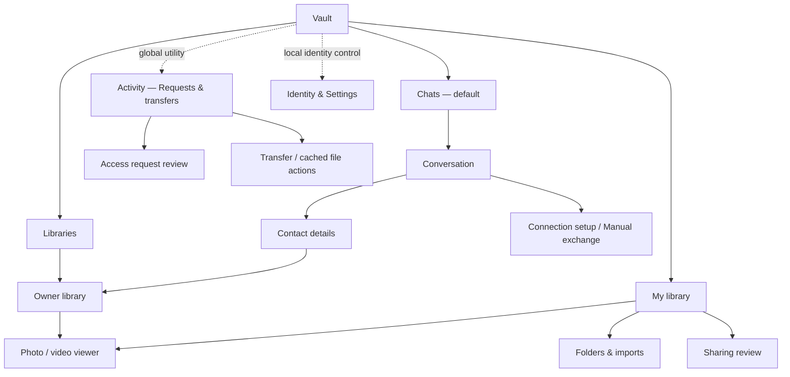

# Vault interface redesign: Quietly personal

Prepared and approved for implementation 2026-10-19. Native verification is recorded in the app README; design targets are not feasibility results.

## 1. Recommendation and scope

Make Vault feel like a thoughtful place for your people and their media, rather
than a control panel for its transport. Keep its unusual privacy and availability
model understandable without making every screen explain the whole architecture.

The direction is **Quietly personal**: warm editorial typography, restrained
forest-green actions, generous but useful space, person-first conversations, and
an immersive media stage. Build on the existing visual identity rather than
replace it with a dating-app skin.

Use three primary destinations: **Chats, Libraries, My library**. Retain
**Activity** as a globally accessible Requests & transfers utility and move
**Settings** behind the local identity control. All existing functions remain
reachable. Simplification comes from hierarchy, context and consistent controls,
not removing consent, hiding errors or pretending connection setup is automatic.

The user approved implementation of this redesign on 2026-10-19. Its navigation
revision is adopted in [the authoritative build plan, section 6.1](../P2P_VIDEO_SHARE_BUILD_PLAN.md#61-uiux-design-track)
and [the companion UI/UX plan](UI_UX_BUILD_PLAN.md). Product, security and native
feasibility constraints remain unchanged. Actual implementation observations,
build evidence and remaining limits belong in the native app README.

### Product boundaries that the design must preserve

- Android and Windows; messenger first, owner-approved media second.
- Device-local protected identity, explicit public-contact exchange and complete
  fingerprint comparison. A name or initials are not identity proof.
- Authenticated direct WebRTC delivery. No operated backend, account, TURN,
  remote push, telemetry, cloud mailbox or automatic offline resend.
- Both peer processes must be running and directly reachable for new messages.
  Already received conversation history remains local.
- Delivered means saved by the recipient app, not read by the person. Unconfirmed
  messages may have arrived; deliberate Retry uses the same message ID.
- Contact verification, direct connection, media approval, local publication and
  public discovery are independent facts and decisions.
- Current media approval covers the whole library, selected folders, future
  refreshes and imports, with browse/play/download for 24 hours. Do not invent
  per-album grants, browse-only protection or an expiry picker.
- Revocation stops future delivery; received, buffered, saved or captured copies
  cannot be recalled. Stopping sharing is not revoking remembered grants.
- Protected identity storage is not a claim that conversation SQLite or media
  copies are encrypted at rest. There is no automatic identity recovery.
- Existing experimental-service and physical-device feasibility limits remain.

## 2. First-principles design brief

### Jobs, not features

A person opens Vault to do one of three things:

1. Talk to someone they know.
2. Browse something that person has explicitly made available to them.
3. Choose and control what they themselves share.

Transport configuration, source administration and diagnostics support these
jobs; they are not the home-screen story. Conversely, an unresolved Manual
exchange is not rare or optional while Manual is the default transport: show it
at the moment it blocks a person's next step.

### Rules for every screen

1. **Person before protocol.** Start with who, their content or the conversation.
   Explain connection mechanics when they matter.
2. **One dominant next action.** A clear primary action per task region, with
   visibly subordinate alternatives. Do not apply this so rigidly that Deny,
   Stop, Back or other safety controls become hard to find.
3. **Recognition before recall.** Stable labels, owner names, accessible controls
   and consistent locations; no gesture-only command or mystery status dot.
4. **Consequences before commitment.** Show the actual person, scope, duration
   and copy limitation before approving or starting sharing.
5. **Continuity is polish.** Keep drafts, selection, useful scroll position and
   recoverable playback context. Do not promise crash-durable drafts that the
   current implementation does not store.
6. **Honesty without alarm fatigue.** Normal disconnected/stopped states are
   neutral. Actionable pending work gets attention styling; real failures and
   identity problems get error styling.
7. **Usefulness before engagement.** No streaks, matches, scores, artificial
   urgency, infinite recommendations or notifications designed to pull people back.

Success is a completed, understood conversation or sharing decision, not time
spent in the app.

## 3. What the current interface tells us

### Evidence reviewed

- Current product/build plan, UI/UX plan, native app README, repository inventory
  and ADRs 0001-0003.
- Production screen/action inventory in
  [vault_app.dart](../apps/vault/lib/production/vault_app.dart),
  [messenger_pane.dart](../apps/vault/lib/production/messenger_pane.dart) and
  [media_viewer.dart](../apps/vault/lib/features/player/media_viewer.dart).
- Existing shared theme/components in
  [components.dart](../packages/vault_ui/lib/src/components.dart), particularly
  lines 7-204 and the semantic status components.
- Existing local phone, wide Windows, Libraries and dark/large-text captures in
  `.audit/messenger-phone-installed.png`, `.audit/messenger-native-wide.png`,
  `.audit/messenger-native-libraries.png` and
  `.audit/messenger-native-compact-dark-large.png`.
- A fresh launch of the existing Windows Debug executable through cua-driver
  0.36.0. The rendered empty Chats surface was inspected alongside its native
  accessibility tree. Local evidence: `.audit/interface-plan-current-windows.png`.

The fresh Windows observation establishes only that existing startup surface.
A background click aimed at Libraries returned an unverifiable synthetic-event
result; the follow-up capture still showed Chats. The artifact named
`.audit/interface-plan-current-libraries.png` therefore records an **unsuccessful
navigation attempt**, not a verified Libraries walkthrough. Other screen findings
come from source and earlier captures. No contact, connection, publication,
approval or user media was changed for this research. No fresh Android walkthrough
or native assistive-technology conformance test was performed.

### Specific problems to solve

| Observation | Evidence | Design response |
|---|---|---|
| Brand header, page heading, subtitle and large enclosing card consume space before the user's task | Fresh Windows startup; existing phone Chats capture | One compact task header; remove the full-page card on compact layouts; keep branding in the shell rather than every detail route |
| Connection setup is prominent even before there is a person to connect with | Empty Chats surface; messenger pane lines 286-421 | Lead with Add person; expose setup contextually after selecting a contact, immediately when Manual work is pending |
| The same pending-frame problem can appear in both the list and conversation, plus Libraries | Existing populated Windows capture; vault_app lines 1543-1578 | One canonical queue, a global count and one relevant contextual explanation rather than duplicate warning blocks |
| Five equal destinations compete on a small phone | Existing phone and large-text captures | Three primary destinations, with Activity and Settings retained as persistent utilities |
| Libraries mixes people, introductions, frame management, discovery and contact administration | vault_app lines 1396-1757 | Known-person browsing first; public discovery and connection details become named secondary routes |
| Message timestamps, delivery explanations and a permanent byte counter compete with actual messages | Existing chat captures; messenger pane delivery/composer sections | Compact metadata, exact status on demand, always-explicit uncertainty, byte feedback when relevant |
| Contact controls are distributed across conversation details, cards and owner controls | vault_app lines 2048-2183; messenger pane lines 158-188 | A consistent Contact details surface with separate connection and two-direction access sections |
| Cards, outlined buttons and prose blocks give many elements similar visual weight | Current captures and shared components | Fewer boundaries, stronger grouping and a deliberate primary/secondary/destructive action hierarchy |
| Large-text compact chat leaves very little timeline space | Existing dark/200%-text capture | Reflow the header and composer, shorten visible metadata without removing its meaning, and avoid fixed-height text regions |
| Native navigation labels appeared as Text rather than invokable buttons in the inspected UIA tree | Fresh Windows snapshot | Explicitly verify destination role, selection and activation with Narrator during implementation; this observation alone is not a conformance verdict |

These are evidence-supported design hypotheses, not findings from a completed
Vault usability study. Validate them before treating visual preference as proof.

## 4. Research and reference decisions

Research used public primary-source documentation and published imagery, not
installed dating-app accounts. Marketing screenshots establish visible composition,
not current interaction behavior or accessibility. Company-reported engagement
results are not evidence that a pattern will improve Vault.

| Reference | What the source actually supports | Transfer to Vault / boundary |
|---|---|---|
| [Hinge product principles, 2026-10-06](https://hinge.co/newsroom/product-design-principles) | Define a user outcome, decompose a difficult journey, and decline features that do not help it | Build around a real conversation and an understood sharing decision. Do not import matching, conversation limits or AI |
| [Hinge Convo Starters and official screen imagery](https://hinge.co/newsroom/convo-starters) | A specific person/content item remains the context for an action | Keep the owner and relevant content close to the action. The editorial treatment is our proposal, not a claim that Hinge documents our typography. No generated openers or new reply/attachment protocol |
| [Bumble homepage and official app imagery](https://bumble.com/en-in/) | Strong person-first composition, restrained chrome and large imagery in promotional examples | Use this content-to-chrome balance for authorized library cards and the viewer, not invented photo profiles or private previews |
| [Bumble redesign announcement](https://bumble.com/en/the-buzz/bumble-new-era) and [current conversation guidance](https://support.bumble.com/hc/en-us/articles/36679912947229-How-conversations-start-on-Bumble) | The old announcement describes Opening Moves; guidance updated 2026-08-10 says it has been removed | Treat the old flow as historical. Borrow a legible next step, not its retired feature, timed matches, opener scoring or pressure |
| [Tinder FAQ](https://tinder.com/faq/) | Swipe-based like/pass mechanics and a consistent safety entry from profiles/conversations | Borrow a predictable route to contact/access controls. Reject swipe-to-approve, matching, scarcity, Boost and public identity-check symbolism |
| [NN/g: Progressive disclosure](https://www.nngroup.com/articles/progressive-disclosure/) | Specialized options can move to clearly labeled secondary surfaces; frequent or blocking actions must remain easy to reach | Secondary network/source detail, not hidden Manual work, Stop controls or consent consequences |
| [NN/g: Recognition rather than recall](https://www.nngroup.com/articles/recognition-and-recall/) | Visible context and recognizable functions reduce memory demands | Stable owner labels, visible Next/Previous, local search scope labels, no tutorial-dependent gestures |
| [Android adaptive list-detail guidance](https://developer.android.com/develop/ui/compose/layouts/adaptive/list-detail) and [Windows navigation basics](https://learn.microsoft.com/en-us/windows/apps/design/basics/navigation-basics) | Lists and details can coexist when space permits; clear, shallow navigation reduces unnecessary movement | One feature model, phone detail routes and a real desktop workspace. Apply the pattern in Flutter; do not introduce Compose or WinUI |
| [Flutter accessible design](https://docs.flutter.dev/ui/accessibility/ui-design-and-styling) and [adaptive input](https://docs.flutter.dev/ui/adaptive-responsive/input) | Large targets, scalable text, meaningful semantics, keyboard focus and input adaptation | Accessibility is a wireframe constraint, not a later styling task |
| [W3C text contrast](https://www.w3.org/WAI/WCAG22/Understanding/contrast-minimum.html), [non-text contrast](https://www.w3.org/WAI/WCAG22/Understanding/non-text-contrast.html) and [unobscured focus](https://www.w3.org/WAI/WCAG22/Understanding/focus-not-obscured-minimum.html) | Measurable readability, control/state visibility and focus requirements | Verify semantic color pairs and focus at real sizes; a warm palette is not permission for faint text |
| [Microsoft motion principles](https://learn.microsoft.com/en-us/windows/apps/design/signature-experiences/motion) and [Flutter reduced-animation API](https://api.flutter.dev/flutter/widgets/MediaQueryData/disableAnimations.html) | Motion should connect states, respond to input and respect platform animation requests | Short, interruptible, purposeful transitions with a static alternative |
| [Flutter performance best practices](https://docs.flutter.dev/perf/best-practices) | Lazy lists/grids, localized rebuilds and restraint with opacity, clipping and offscreen layers | Make smoothness a rendering/resource constraint, not a layer of blur and animation over expensive screens |

**The dating-app lesson is intimacy of attention, not dating mechanics.** A
person should feel identifiable and an action intentional. Vault does not need
romantic imagery, a card-swiping home, fabricated profiles or new social features.
Do not copy logos, illustrations, photographic assets or brand trade dress.

## 5. Visual language

### Composition

- Remove the rounded box enclosing the whole compact page. Let the page be the
  surface; use cards only for distinct content or decisions.
- Use clear vertical rhythm and shared alignment before adding more dividers.
  A list row is not a separate card by default.
- Keep headers useful and short. No permanent marketing hero above a working
  library and no repeated eyebrow/title/subtitle stack on every screen.
- Let messages and real authorized media occupy most of the content area.
  Decorative whitespace must not displace the next useful row on a phone.
- Use a stable bottom navigation bar, not a floating island overlapping content.
  Avoid frosted glass, animated gradients and large shadow stacks.
- Give primary, secondary, utility and destructive actions distinct treatments.
  Shape alone must not suggest that every action is equally important.

### Tokens and assets

Reuse the existing `vaultTheme`, bundled Lora/`VaultSerif`, Roboto functional text,
Material controls and light/dark semantic roles. Do not add a font network request,
a new icon family or a UI framework.

| Element | Adopted specification |
|---|---|
| Background | Existing warm paper light surface / deep green-charcoal dark surface |
| Primary action | Existing evergreen primary and its paired onPrimary color |
| Content emphasis | High-contrast ink, then legible secondary text; no pale-gray body copy |
| Editorial heading | Existing VaultSerif, approximately 28-32 logical pixels on compact top-level pages; larger only where space helps |
| Functional type | Existing sans-serif; body about 16, list name about 16-18, supporting metadata about 12-14 logical pixels; all scale with the platform |
| Spacing | Existing 4/8 rhythm: 8, 12, 16, 24, 32; compact page gutters start at 16 |
| Shape | Existing modest rounding, roughly 12-16 on actions and 16-20 on content/decision cards; no unnecessary nested rounding |
| Targets | At least 48 by 48 logical pixels; visible icon can be smaller than its hit area |
| Avatars | Existing initials and neutral color treatment; no photo-profile feature or image upload |
| Media stage | Near-black, low-distraction viewer; controls remain readable over actual content |
| Status | Neutral, confirmed, needs action, failed/ended; icon plus specific text, never color alone |

Sizes are starting design values, not frozen acceptance results. Prefer existing
text roles to screen-specific hard-coded styling. Verify all real color pairs;
do not assume the seed-generated palette automatically meets every contrast need.

## 6. Information architecture

### Navigation behavior

- Primary destination labels stay visible. Libraries means other people's
  libraries; My library means sources on this device. Avoid vague Explore/You
  labels that blur this distinction.
- Activity has a stable global entry with an accessible Requests & transfers
  label and a badge for pending decisions. On compact layouts an icon may use a
  tooltip and semantic label; relevant requests are also visible in My library.
  No alarm badge merely because no peers are connected.
- The initials/identity control opens Identity & Settings. On wide Windows,
  utilities remain visibly pinned below the primary sidebar destinations; they
  are not hidden in an arbitrary overflow menu.
- On compact conversation and viewer routes, remove redundant global branding
  and use Back plus a task-specific header. The media viewer is fullscreen;
  top-level navigation does not compete with playback.
- Entering a utility/detail preserves its originating destination, selected
  person, draft and scroll state. Back/Escape returns there, not always to home.
- Preserve navigation and per-person drafts through resizing. Retain existing
  draft lifetime; do not introduce an offline outbox or promise restart recovery.
- Activity remains a reachable screen, not only a dismissible notification.
  Its location changes; its underlying persistence guarantees do not.

## 7. Screen and flow specifications

### 7.1 First use and startup

Use the real empty state as onboarding; no carousel, profile-completion score or
forced media import. After protected bootstrap succeeds, show one useful promise:
**Your people. Your media. Your choice.** Lead with Add person and a secondary
Share my contact action. Briefly explain device-local identity and the need for
both apps to be running/reachable when exchanging new messages.

Do not change the identity-creation/storage lifecycle as part of a visual rewrite.
Never show an interactive success screen before protected bootstrap completes.
Storage failure and second-instance refusal keep their blocking, recoverable
surfaces. Retry is allowed; automatic reset, plaintext fallback and Clear all
storage are not recovery shortcuts.

### 7.2 Chats list

- Compact header: Chats; Add person is the dominant action. Keep contact search
  available with the honest label **Search contacts**, not Search everything.
- Rows prioritize initials, full accessible name, last message/draft preview,
  local time and actual unread count. Supporting connection text is restrained.
- Preserve a useful distinction between a contact without messages, an empty
  contact list and a search with no matches. A search miss must not suggest the
  person's saved conversation was deleted.
- Empty state explains exchanging public contacts and comparing fingerprints,
  not networking terminology. No seeded people or sample conversations.
- No swipe-to-delete, swipe-to-connect, pinned/favorite feature, global history
  search or smart sorting unless already supported by a real contract.

### 7.3 Conversation and composer

- Header: person, concise actual connection state and a predictable Contact
  details entry. Human fingerprint comparison is separate from session
  authentication; do not present a generic blue identity check.
- Message content gets the strongest visual weight. Use comfortable bubble
  widths, restrained incoming/outgoing tones and compact sender-time metadata.
  Preserve the existing ordering and selectable text.
- Keep sending/delivered/received semantics available for each message through
  accessible labeling/details. Show Unconfirmed and its Retry action explicitly;
  never conceal uncertainty behind an unlabeled checkmark.
- Explain **Delivered = saved by their app, not read** in message details and
  contextual first-use help, rather than repeating a paragraph under every bubble.
- Composer grows to a bounded multiline height above the keyboard. Keep Send
  reachable, with a proper target and semantic label.
- Retain the exact 4096 UTF-8-byte bound. Expose limit help accessibly; show an
  exact counter near the limit or on error instead of permanently spending a
  separate row on `0 / 4096 UTF-8 bytes`. Do not relabel bytes as characters.
- A disconnected draft remains editable locally if current behavior permits;
  Send stays disabled with an explanation and Connect action. Never label it
  queued or send it automatically after reconnection.
- Retry the original unconfirmed message, not a new composer copy or ID.
- Preserve typing focus, per-person drafts and timeline position while opening
  a library, utility or resized layout. Do not auto-scroll someone away from
  older messages merely because another message arrives; offer a visible new
  message/jump-to-latest affordance when they are reading above the bottom.
- No new attachment, voice, call, reaction, edit-message, remote typing or read
  receipt affordances: the current product has no corresponding delivery contract.

### 7.4 Add person and Contact details

Replace generic input-plus-confirmation styling with a focused public-contact
flow: enter/paste public contact, inspect parsed name and complete fingerprint,
compare through an independent trusted channel, then explicitly add. Do not
substitute a short code, QR scanner or matching display name for comparison.
The current supported exchange is public contact text; camera permission is not
part of this redesign.

Superseded on 2026-10-20 by [ADR 0005](adr/0005-connection-setup-ux.md):
the owner approved QR pairing with an Android camera scanner and a confirmed
one-tap public broker preset. Manual contact text exchange remains available.

Contact details is a consistent sheet on compact layouts or supporting pane on
wide layouts. It owns:

- Name, initials, complete selectable fingerprint and comparison explanation.
- Connect/Disconnect and a labeled Connection setup entry.
- **Your access to their library** and **Their access to your library** as
  separate sections; never one ambiguous Sharing allowed switch.
- Request/check existing approval/open-library actions when their actual states
  permit them; repeated opening must not automatically submit another request.
- Revoke access, export public contact and remove contact, with clear consequences.
  Removal preserves the actual revoke/disconnect behavior and does not claim to
  erase remote copies or automatically delete local conversation history.

Do not add a rich profile, bio, photo upload, account/recovery control, block/report
service or editable trust badge without an existing service behind it.

### 7.5 Connection setup and Manual exchange

This is the design's hardest constraint, not something a polished mockup may omit.

- When Connect requires user-mediated exchange, explain **Exchange connection
  information with this person** and open the real queue. A quiet Details section
  can expose transport terminology.
- Keep every pending offer/answer/acknowledgement frame reachable. Show queue
  position/count, actual errors and available expiry/deadline information. New
  frames can appear while exchanging; no rigid two-step offer/answer fiction.
- Use concrete actions: Copy/export frame, Import reply, and Remove from queue.
  Copying is not transmission, removal is not acknowledgement, and emptying the
  local export list is not proof of a connected session.
- A pending count remains globally discoverable, with one contextual strip in
  the affected conversation or library. Where peer attribution is unavailable,
  show the complete queue rather than inventing attribution.
- Use attention styling for normal work waiting on a person. Invalid/expired
  data or a failed negotiation uses a real error and relevant recovery.
- Keep Manual and configured MQTT TLS behavior honest. MQTT may automate frame
  exchange, but neither mode guarantees a direct route or provides a chat mailbox.
- Network configuration remains in Settings, with a direct link from setup.
  Do not bundle a default broker, hosted invite link, new pairing transport or
  claim that manual exchange fixes NAT/firewall failure. ADR 0005 later added
  an opt-in broker preset and QR pairing; the NAT rule still holds.

### 7.6 Libraries and owner library

The top-level surface is a finite collection of known people, not a public feed.
Use a small heading, local contact search, All/Ready to browse filters and clear
person cards. Each card has a name and one relevant next action: Connect,
Request access, Check earlier approval or Open library, based on real state.

Use larger imagery only after actual authorization and successful preview
loading. Before approval, use initials or a neutral library illustration, not
blurred private thumbnails or an invented photo collage. An unavailable poster
is a real unavailable state with retry where supported, not stock artwork.

The owner library has:

- Persistent owner identity, Back, concise connection/access context and Refresh.
- Search over filenames in the loaded authorized index, with its actual scope
  stated. No claim of global, semantic or full-device search.
- Existing photo/video type filters, stable pagination at 100 items and preserved
  position when returning from the viewer. Do not add album/date/favorite controls
  unsupported by current indexing and authorization.
- A regular grid with stable tile geometry; avoid masonry jumps while posters
  arrive. Crop thumbnails only; the viewer fits original media.
- Type/duration/metadata only when actually known. Video never autoplays in a grid.
- Distinct empty, loading, no-match, inaccessible and unavailable-owner surfaces.
  Never leave a stale authorized grid actionable after access/session termination.

Public discovery moves to a named secondary route under Libraries. Preserve
independent Listen for listings and List me publicly choices, both off by default.
Review exactly the public fields supported by the current adapter: identity/
binding, display name and indexed item count. Do not add public avatars, paths,
filenames, posters or profile fields from another application's design.
Results are partial, locally cached and expiring, not global discovery. Manual
mode explains that it does not support this directory. Adding a result still
requires full-fingerprint comparison; no auto-add, connect or approval.

### 7.7 My library, sources and starting/stopping sharing

Make this an owner workspace, not a settings dashboard. Content is primary; a
compact sharing panel states **Sharing off** or the observed active state.

- Add media offers the existing two distinct choices: **Add folder** references
  originals; **Import media copies** makes app-owned copies. State the storage
  consequence before selection. Do not silently duplicate the whole library.
- Folders & imports owns source list, explicit refresh, per-source failures,
  source removal and supported indexed-entry removal. Removing a source/index
  entry is not deleting originals or recipients' copies.
- Show enumeration, hashing and metadata/poster work separately using real
  counts/stages. Unknown total means indeterminate progress, not a fake percent.
- First Start sharing opens a readable review of the actual whole-library scope,
  current selected sources, approval requirement, 24-hour access consequence,
  future refreshes/imports and received-copy limitation. Do not show cosmetic
  per-item privacy selectors that the authorization model cannot enforce.
- Start sharing remains separate from adding files, granting access and public
  listing. Native eligibility/permission failure leaves sharing off.
- While sharing, expose a compact global state/control and **Stop sharing** from
  every relevant surface, plus existing native Stop controls. Stopping must not
  wait behind decorative animation or a buried confirmation. It stops future
  serving without silently revoking grants or ending a usable messenger session.
- Windows Close-to-tray versus Quit stays explicit; login launch only opens the
  app. Android foreground-service/budget limits stay accurate. Nothing implies
  always-on hosting, automatic publication at launch or guaranteed reachability.

### 7.8 Access requests and Activity

Activity is a stable utility route titled **Requests & transfers**, with clear
Requests and Transfers sections. It is never only a toast or compulsory modal.
Badge pending local decisions, not all routine connection events. Show owner
requests contextually in My library as well, linking to the same review.

Each access review shows the authenticated fingerprint, who is asking, whole
scope, browse/play/download actions, 24 hours, future refresh/import inclusion
and the received-copy limitation **before** the approval action. Approve and Deny
are explicit labeled controls, not a swipe or romantic yes/no card.

Approval still requires active publication. If it is off, offer Start sharing
with an explanation, then return to the request; starting sharing does not approve
it. Revalidate request eligibility at commit and guard repeated submissions.
Use one complete review instead of two repetitive generic confirmation dialogs,
without shortening the actual security decision.

Preserve the distinction between transient requests, approvals made this run and
persisted grants/revocations. Do not manufacture a durable approval audit trail
or persistent transfer history from current in-memory lists. Earlier grants remain
revocable through the contact controls the runtime actually supports.

### 7.9 Viewer, transfers, cache and Save copy

Preserve the existing native player and real cleanup/recovery contracts. Polish
its surrounding hierarchy instead of replacing working controls with an attractive
but incomplete custom player.

- The media stays dominant on a dark stage. Back, owner, item position,
  Previous/Next, Details and appropriate media actions remain discoverable.
- Photos retain fit, zoom, pan and accessible alternatives to gestures. Gallery
  order follows the current filtered scope, never an automatic slideshow.
- Videos retain play/pause, seek/time, volume and fullscreen. Primary actions
  remain reachable when the video overlay hides. No quality ladder, transcoding
  implication, autoplay feed or live camera control.
- Show true loading/buffering/seeking/reconnecting/ended states. A requested seek
  is not confirmed playback, sparse gaps are not buffered, and unreceived bytes
  are unavailable when the owner cannot serve them.
- Recoverable interruption retains the item and eligible playback context while
  authorization/source access is checked again. Explicit disconnect, terminal
  failure and revocation are not optimistic reconnect loops. Switching away does
  not secretly resume video on return.
- Next/Back/close retires matching reads, decoders, listeners and old progress;
  late completion from an earlier item cannot repaint a new one.
- Transfers expose actual verified-byte progress, cancel, applicable interrupted
  state and currently supported resumability. No invented ETA or download speed.
- A cached completion is **Available in app cache**, not Saved to your files.
  **Save copy…** opens the OS destination picker; success appears only after the
  copy completes. Picker cancellation is not success.
- **Delete cache** affects app-managed temporary copies only. Never imply it
  deletes exported files, originals or copies held by another person. Keep the
  current completion-list lifetime explicit rather than invent persistent history.

### 7.10 Identity & Settings

Use short category rows with a current summary and a focused detail view, rather
than one long wall of expandable architecture text. Preserve the existing controls:

- **Your identity:** display name, public contact export and complete fingerprint;
  name is not a unique username, and export contains no private keys.
- **Appearance:** existing light/dark choices, using the shared theme.
- **Connection settings:** Manual or MQTT TLS host/port, start/stop and actual
  status, public configuration import/export and existing change restrictions.
- **Availability:** actual native mode/status, refresh, Windows tray/login-launch
  controls where supported, accurate Android permission/service explanations.
- **Privacy & security:** independent sharing/discovery decisions, protected
  identity versus unencrypted-at-rest history, received-copy limits and no
  automatic key recovery/export.
- **About this build:** experimental status and measured-versus-open gate limits.

Cache-file actions remain reachable in Activity. Do not invent a global storage
accounting dashboard, cache-budget slider, uplink cap, diagnostics-export feature,
backup, new protocol options or controls from planned-only historical screens.
A later product change can add capabilities; the redesign must not display them
as working simply because an older design document mentioned them.

## 8. State, attention and recovery contract

Keep underlying identity, human comparison, signaling, direct session, grants,
publication, discovery, source and message states independent. A compact headline
can summarize the relevant dimension; Details exposes the others. The UI derives
facts from existing services, not a second widget-owned permission model.

| Situation | Presentation and next action | Invariant |
|---|---|---|
| Protected startup fails / another instance owns storage | Blocking explanation with supported Retry or already-running guidance | No network start, key reset or plaintext fallback |
| Identity differs from saved contact | Prominent identity problem; independent verification | No trust transfer by display name or silent contact merge |
| Contact not connected | Neutral state and Connect | Local history remains readable; no automatic send or media grant |
| User deliberately disconnected | Disconnected by you; explicit Connect | Recovery/restart never overrides that intent |
| Manual frames need exchange | One actionable attention strip and queue entry | Every frame remains reachable; export/cleanup is not acknowledgement |
| Signaling unavailable, direct session usable | Explain new-connection/discovery issue in the relevant context | Do not disable a working direct chat or imply the broker carries text |
| Transient direct interruption | Reconnecting, preserve useful context, expose deliberate stop | No premature Delivered or automatic offline resend |
| Direct route cannot be established | Clear failure, Retry/setup details, coordinate or try another permitted network | No certain NAT/sleep diagnosis, relay fallback or guaranteed fix |
| Access pending / denied / expired / revoked | Use the actual known state and its permitted next action | No repeated auto-request, private preview or stale authorized action |
| Terminal access/session end in viewer | Stop further fetching; explain what ended and what copies may remain | No claim to erase bytes already received |
| Source permission/content changes | Localized source/item explanation and native recovery where supported | Do not remove unrelated sources or serve stale/changed bytes |
| Missing poster / unsupported media | Neutral unavailable preview or explicit playback failure | No fake thumbnail, codec support or successful decode |
| Destination full / copy fails / picker cancelled | Accurate local outcome and available destination/cache action | No Saved state before complete copying; no automatic original deletion |
| Message unconfirmed | May have arrived; Retry on that exact message | Same ID, no new-message duplicate or false read receipt |

Give a problem one owner: global issues have one shell entry, local issues have
an inline explanation. Counts may mirror that entry, but do not stack duplicate
banners. Priority is storage/identity integrity, terminal access constraints,
blocking user action, then transient information. Do not let this visual priority
hide multiple independent issues from the Details route.

Use brief confirmations for reversible local completion, persistent rows for
pending decisions/errors, and consequential review for sharing/revocation/removal.
Confirm with the actual affected person/scope, not a vague Are you sure? Never
offer Undo for a revoked authorization token; reapproval is a new decision.

## 9. Motion and smoothness

Motion explains where something came from or acknowledges input. It does not
prove network success, extend a wait or delay Stop/Back/Cancel. Reuse platform/
Flutter transitions where possible; custom motion must justify its cost.

| Interaction | Starting target, not a benchmark result | Reduced-motion behavior |
|---|---|---|
| Press, focus and small state feedback | Immediate response; roughly 120-160 ms for decorative emphasis | Instant state change with visible focus/selection |
| Top-level destination change | Roughly 160-200 ms subtle fade; no entire-page slide carousel | Instant or minimal non-spatial fade |
| Open conversation / return | Roughly 180-240 ms directional transition consistent with Back | No large translation |
| Open contact/access sheet | Roughly 200-280 ms, preserving its originating context | Instant placement with correct focus |
| Open media | Short connected transition only for an already authorized/available image; otherwise normal loading state | Direct open, no zoom travel |
| New message / status | Small local appearance/change without list reordering or forced scroll | Static insertion and semantic announcement |

No looping shimmer, breathing availability dots, elastic swipe cards, floating
particles, confetti for approval, parallax or auto-advancing media. A loading
placeholder communicates only an operation that is actually in flight.

Adapt explicit animations to platform reduced-animation requests and verify both
Android and Windows. Finish animations quickly or cancel them when navigation
changes; stale completion must not restore an old route or focus target.

## 10. Android and Windows adaptation

Use available logical width and input needs, not the platform name alone. Start
with existing thresholds, then validate with real content and large text.

| Workspace | Adopted behavior |
|---|---|
| Under 600 logical pixels | Three labeled bottom destinations on top-level screens; one task/detail at a time; full-height routes for long consent/setup forms |
| 600-899 logical pixels | Compact labeled rail if it leaves useful task width; one main pane unless list and detail genuinely fit |
| 900 logical pixels and wider | Labeled sidebar, primary content workspace; utilities/profile anchored consistently |
| Chats with at least 760 logical pixels available after navigation | List/detail, roughly 300-360 for the list and the remainder for conversation |
| Optional supporting detail pane | Only when the remaining conversation/library still meets its minimum usable width; otherwise a modal/detail route |

At large text or translated labels, prefer fewer panes before squeezing controls.
Do not turn an accessible wide layout into three narrow columns. Preserve the
selected person/item as the layout changes.

Android: respect safe areas, IME insets, system Back and predictive-Back behavior
supported by the installed Flutter stack. Use SAF/document dialogs only at the
relevant action. Do not request storage, notifications, battery exemptions, camera
or microphone during empty-state onboarding.

Windows: keyboard-complete navigation, selectable text, clear pointer/focus
feedback, native folder/save dialogs, sensible DPI scaling and explicit tray/Quit
semantics. Context menus may duplicate commands, never be their only route.
Keep current viewer shortcuts; scope global accelerators so typing, IME input,
text selection and player controls do not conflict. Native Enter/Space/Back
behavior takes priority over a novel shortcut scheme.

## 11. Accessibility and language acceptance

- At least 48-logical-pixel targets, including avatar/utility icons and viewer
  actions. Separate adjacent consequential actions sufficiently.
- At least 4.5:1 normal text, 3:1 qualifying large text, and 3:1 essential
  control/state indicators against adjacent surfaces. Verify both themes and
  real media-overlay conditions, not only design tokens in isolation.
- Text scaling to 200% without clipped names, fingerprints, scope, Back, Stop,
  Send or consent choices. Long content scrolls; essential text is not hidden
  in fixed-height sheets or shrunk to fit.
- Keyboard traversal follows task/reading order. Modal focus is contained;
  dismissal returns it to the opener. Sticky chrome and the software keyboard
  do not obscure focused controls.
- Narrator/TalkBack can identify destination roles and selection, people,
  connection/access distinctions, message delivery and media controls. Announce
  meaningful changes without speaking every progress tick or moving focus.
- Gestures always have visible/actionable alternatives. No hover-only control,
  swipe-only action, color-only trust cue or motion-dependent information.
- Respect reduced motion, high-contrast settings and native accessibility
  behavior supported by the Flutter/OS combination; verify actual outcomes.
- Use localization-safe layout, RTL directionality and sensible fingerprint/
  filename handling. Keep complete fingerprints selectable and comparable;
  visual grouping must not alter copied data.
- Avoid Account, Online now, Secure forever, Read, Upload, Cloud backup and
  Saved when they do not describe the actual operation. Use specific verbs:
  Add person, Connect, Request access, Start sharing, Stop sharing, Revoke access,
  Download to cache, Save copy and Delete cache.

## 12. Rendering and resource plan

Smoothness is continuity plus bounded work, not simply longer animations.

- Keep the timeline, contact list and media grid lazy. Preserve stable item keys
  and existing pagination/bounds; do not mount an entire 10,000-message history
  or 20,000-item source just to animate it.
- Reuse existing bounded local/remote thumbnails and two-lane remote preview
  loading. No unauthorized speculative fetch or decoding full originals into
  card thumbnails. Do not refetch posters merely because the parent rebuilt.
- Localize rebuilding to the relevant message, progress row, state strip or
  player control. Typing or transfer progress must not rebuild the whole shell.
- Keep hashing, filesystem/SAF work, heavy decoding and network processing out of
  widget build/layout. Do not add avoidable copies, repeated sorting or a second
  unbounded presentation cache.
- Avoid expensive intrinsic layout across grids, broad opacity layers, repeated
  clipping, backdrop blur and shadow stacks. Use existing native controls and
  simple painted surfaces.
- Preserve existing cancellation/generation/session guards and dispose matching
  resources on route/item change. Navigation polish cannot weaken cleanup.
- Use the current state/service composition. A visual redesign does not justify
  a new router, state-management framework, transport wrapper or dependency.

Measure on named hardware and profile/release-appropriate builds. Initial targets:
local input produces visible feedback within 100 ms; during steady-state scroll
and transitions, p95 UI and raster work each fit the display frame budget
(16.7 ms at 60 Hz; 8.3 ms at 120 Hz where actually tested). Report cold decode,
startup and transport latency separately rather than presenting them as animation
performance. Measure baseline before optimizing; these numbers are not claims of
current performance or guaranteed direct delivery.

Exercise empty, ordinary and boundary-sized supported data sets, long names,
missing posters, active transfers and reconnecting sessions. Do not clear user
state or inject sample contacts into the normal application to create screenshots.

## 13. Implementation sequence and ownership

The user approved this cutover and the production app now implements its screen
hierarchy. The sequence records the implementation contract, not a new scaffold.
The app README separates exercised native behavior from the remaining human,
assistive-technology, performance and physical-device acceptance work.

| Stage | Deliverable and concrete target | Exit requirement |
|---|---|---|
| 1. Reconcile contracts and baseline | Adopt navigation revision in the main plan/UI plan; enumerate every existing action and its destination; record native baseline with isolated identities | No lost action, invented backend capability or changed consent scope; current-versus-proposed status is unambiguous |
| 2. Wireflows and visual specification | Compact/wide, light/dark and large-text frames for every section 7 surface; state/recovery branches; token/component/keyboard specification | Every action has a service command, pending state, real outcome, cancellation and recovery; owner/viewer and Manual journeys complete |
| 3. Shared tokens and adaptive shell | Update existing vault_ui components and production shell; three primary destinations, persistent utilities, correct route/focus/resize behavior | Real native shell works without resets; all existing routes reachable; utility and Back behavior preserve drafts/selection |
| 4. People, conversation and connection | Redesign messenger pane, consistent Contact details and canonical Manual queue using current runtime/service behavior | Real two-peer text/reply and same-ID uncertainty/retry work; no hidden pending frames; local history survives restart; no offline outbox |
| 5. Owner/viewer media and decisions | Redesign known libraries, authorized grids, sources, sharing review, requests/transfers and Settings | No preview before approval; whole-scope/24-hour decision is understood; publication/discovery independent; stop/revoke and cache/save correct |
| 6. Viewer refinement and continuity | Refine media_viewer surrounding chrome without replacing native player contracts | Image navigation, zoom/pan, seek, cancellation, interruption, authorization recheck and terminal end paths exercised on both platforms |
| 7. Native accessibility/performance acceptance | TalkBack/Narrator, keyboard, IME, DPI, large text, RTL, reduced motion, profile traces and platform lifecycle walkthrough | Evidence for the acceptance scenarios below; actual defects fixed; remaining lower-layer feasibility gates reported separately |

Implementation boundaries:

- `apps/vault/lib/production/vault_app.dart`: shell, existing runtime commands,
  source/publication/discovery/request/settings composition. Extract focused
  feature widgets only where the redesign needs them; no unrelated architecture
  cleanup or competing production shell.
- `apps/vault/lib/production/messenger_pane.dart`: contact list, timeline,
  composer, details and connection-task presentation. Preserve messenger service
  persistence, limits, unread behavior and idempotent retry.
- `packages/vault_ui/lib/src/components.dart`: existing shared visual language
  and genuinely reused presentation components. Do not promote study-controller
  permission booleans or historical sample screens into production state.
- `apps/vault/lib/features/player/media_viewer.dart`: media chrome and adaptive
  controls, retaining cleanup, recovery and native player boundaries.
- `apps/vault/lib/platform/`: preserve native pickers, protected storage,
  single-instance lock, availability and save behavior. Only change presentation
  integration where the redesigned flow requires it.
- Identity/protocol remain pure Dart; the WebRTC adapter boundary is unchanged.
  A service gap is a product decision, not permission to simulate success.

Use references before changing exported symbols. Migrate affected production
callers in one cutover; remove obsolete production controls/aliases made redundant
by that cutover. Do not delete unrelated historical studies or user changes.

During implementation, update consumer-visible behavioral contracts where they
actually change. Preserve existing persistence, retry, consent, source and player
regressions. New permanent tests should target plausible bugs such as lost drafts
on adaptive navigation, granting a changed request, fetching before approval or
late viewer results after switching items; do not add tests pinning wording,
widget nesting, copied defaults or mock echoes.

After integration, run the repository's existing analysis/format and relevant
component behavioral commands once as appropriate, then exercise actual native
flows. No new tooling installation is part of this design. Follow
[the app build instructions](../apps/vault/README.md#build-and-run) and existing
verification scripts; never reinstall/clear an identity-bearing application to
work around a version mismatch.

Update the current UI/UX plan, root/app/shared-UI READMEs and inventory only for
what was actually implemented and observed. Retire this document's proposal
status at adoption, and keep historical research clearly labeled. Do not claim
that attractive screenshots close transport, security, performance or Phase 0 gates.

## 14. Acceptance scenarios

The redesign is complete only when all reachable current tasks have real native
implementations, not just screens. The following are required observations for
the later implementation, not results of this planning task.

1. A fresh user reaches Add person without importing media, configuring discovery
   or requesting irrelevant OS permissions. Protected bootstrap failure remains
   blocking and does not reset identity.
2. Two people exchange public contact text, compare complete fingerprints, add
   each other, complete all required Manual frames and reach an authenticated
   session. A same-name different-key contact inherits no trust/access.
3. Actual chat/reply shows recipient-save delivery, local unread/history and
   selectable text. Unconfirmed remains understandable; explicit Retry does not
   create a second received copy. No read receipt or automatic offline resend.
4. Switch destinations, open a library/details/Activity, resize wide-to-compact
   and return while typing: correct person, existing draft lifetime and useful
   scroll state are preserved; IME input and focus remain functional.
5. With several pending Manual frames, all are reachable from the affected task
   and global entry. Copy/remove operations never falsely claim acknowledgement
   or connected status. Normal setup is not represented as a catastrophic outage.
6. Add a Windows folder/Android SAF source without serving it. Refresh and source
   removal have correct original-versus-imported-copy consequences. Permission
   loss, missing/changed content and unknown indexing totals stay truthful.
7. First sharing review and owner approval accurately expose whole-library scope,
   future imports/refreshes, browse/play/download, 24 hours and copy limitations.
   Starting sharing alone neither approves a request nor lists the owner publicly.
8. An unapproved person sees no private index/poster/media. An approved person can
   browse/filter/page actual authorized content, open a photo/video and return to
   the same relevant grid context. No fabricated covers on failed previews.
9. A cached image/download, user-saved copy, cancelled picker and failed/full
   destination each have distinct observed outcomes. Delete cache leaves originals
   and exported files alone; resume requires current authorization.
10. Short interruption can recover eligible viewer context; explicit disconnect,
    access termination and terminal failure stop new reads and do not auto-reopen.
    Next/Back/close leaves no old media/progress/resource attached to the new item.
11. Stop sharing stops new media serving while a valid messenger conversation can
    continue. Revoke and Remove contact perform their actual persisted effects;
    UI language never promises deletion of someone else's received copy.
12. MQTT failure does not disable an established usable direct session. Directory
    results remain partial/expiring, and public listening/listing stay independent.
13. Android notification/Stop and Windows tray/Close/Quit/login-launch flows match
    the actual supported lifecycle. Return/restart does not implicitly reconnect,
    republish or begin public discovery against explicit user intent.
14. Keyboard-only Windows and native Narrator/TalkBack walkthroughs can add,
    connect, review, approve/deny, browse, seek, save and stop. Selection semantics,
    focus return, 200% text, narrow/wide, both themes, RTL and reduced motion work.
15. Named-device traces cover scrolling, typing with transfers, opening media and
    adaptive resizing at realistic and supported boundary sizes. Report measured
    frame/input results, cold work and limitations separately; no untested 120 Hz
    or always-available claim.

For each executed scenario record build/revision, platform/device, topology where
relevant, isolated data setup, steps, observed result and limits. UI evidence must
be paired with actual service enforcement for approval/revocation claims.

### Qualitative usability review

Before final visual polish, run a moderated exploratory review with roughly 6-8
people unfamiliar with Vault, covering Android and Windows and both owner/viewer
roles. Include keyboard/large-text or assistive-technology use in recruitment or
separate native accessibility sessions. Obtain consent; record locally without
product telemetry. This sample is for finding problems, not a statistical claim.

Ask participants to start a conversation, recover a failed connection, request and
approve media, save a copy and stop access. Observe unaided completion, wrong
turns and interpretation of statuses. Specifically ask what is shared, whether a
contact can already see media, what Delivered means, why an uncached item may be
unavailable and whether revocation deletes a saved copy. Fix and retest all
security-sensitive misunderstandings; task speed cannot compensate for an
incorrect consent model.

## 15. Explicit exclusions

This redesign does not add rich profiles, photo avatars, matching, swipe consent,
AI openers, reactions, remote typing/read indicators, chat attachments, calls,
QR pairing, cloud recovery/sync, automatic offline delivery, global/semantic
search, albums/favorites, per-item grants, a new durable activity store, live
broadcasting, TURN, new discovery transports, product analytics or new branding
assets. Planned-only historical controls must not be presented as implemented.

Any future feature needs its own product/service contract. The complete current
experience should feel simpler because it is organized better, not because it
quietly grew into another application.

## 16. Implementation and acceptance evidence

The redesign is implemented in the existing production shell, messenger, media
viewer and shared theme—not in a replacement study controller. The authoritative
navigation contracts and affected consumer documentation are updated together.
Behavioral regressions cover adaptive task continuity and actual consent/cache
state transitions; the [native app README](../apps/vault/README.md#verification)
records the specific exercised builds, native scenarios and their limitations.

The original research used repository/product constraints, a production
screen/action inventory, Windows startup inspection, existing native captures,
primary-source UX/platform guidance and official dating-product imagery. It was
not comparative product testing.

Implementation does not pass the full acceptance matrix by itself. Recruited
usability review, TalkBack/Narrator, physical Android, realistic network/lifecycle
trials and hardware-named performance targets remain unvalidated unless an
explicit observed result is recorded. No study, screen-reader pass, benchmark or
Phase 0/1 feasibility result is inferred from screenshots or developer builds.
